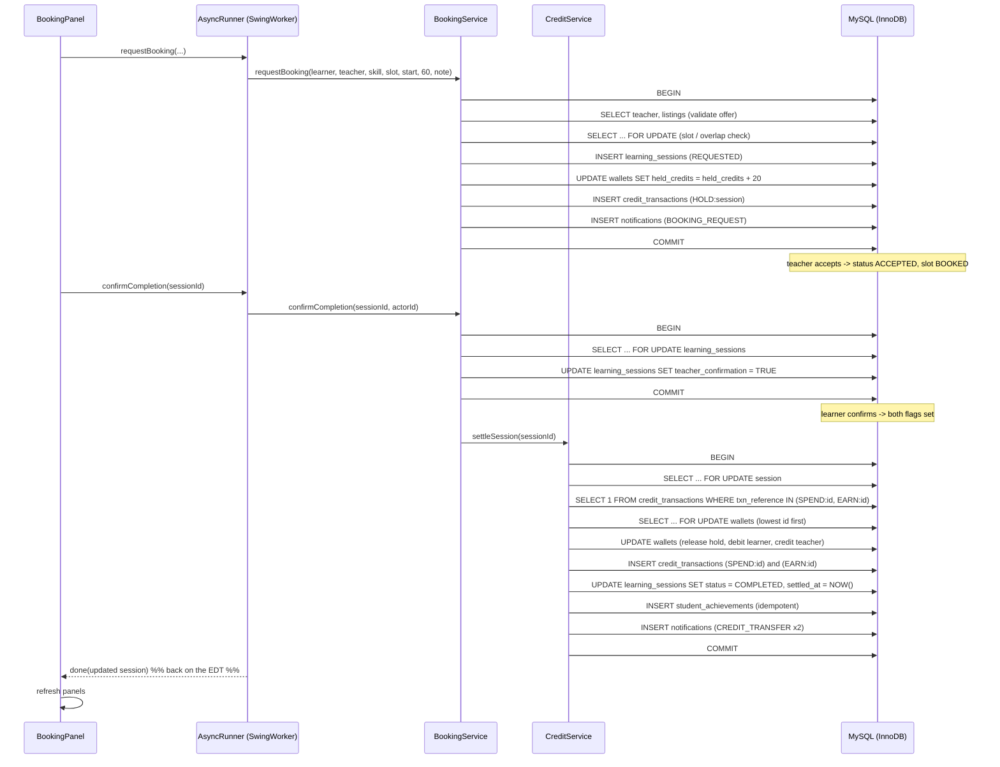

# SkillLoop – Class Diagram

104 classes in `src/main/java/com/skillloop` (28 model, 13 DAO, 12 service, 24 UI, 9 util,
9 exception, 4 tools). The diagrams below show the real classes and their real members; the
complete reference is the source itself.

---

## 1. Layer overview

```mermaid
classDiagram
    direction TB

    class Main {
        +main(String[] args)
    }
    class LoginFrame
    class RegisterFrame
    class DashboardFrame
    class AdminDashboardFrame
    class AsyncRunner
    class Refreshable

    class AuthService
    class StudentService
    class SkillService
    class MatchingService
    class BookingService
    class CreditService
    class ReviewService
    class NotificationService
    class AchievementService
    class GroupSessionService
    class ResourceService
    class AdminService

    class StudentDAO
    class SkillDAO
    class SessionDAO
    class AvailabilityDAO
    class WalletDAO
    class CreditTransactionDAO
    class ReviewDAO
    class NotificationDAO
    class AchievementDAO
    class ResourceDAO
    class GroupSessionDAO
    class AdminDAO

    class Student
    class Skill
    class StudentSkill
    class LearningSession
    class Wallet
    class CreditTransaction
    class Review
    class Notification
    class AvailabilitySlot
    class Achievement
    class GroupSession
    class LearningResource

    Main --> LoginFrame : starts
    LoginFrame ..> AuthService : calls
    RegisterFrame ..> AuthService : calls
    DashboardFrame ..> StudentService : calls
    DashboardFrame ..> SkillService : calls
    DashboardFrame ..> BookingService : calls
    DashboardFrame ..> CreditService : calls
    DashboardFrame ..> ReviewService : calls
    DashboardFrame ..> NotificationService : calls
    DashboardFrame ..> GroupSessionService : calls
    DashboardFrame ..> ResourceService : calls
    MatchingPanel ..> MatchingService : calls
    AdminDashboardFrame ..> AdminService : calls
    AsyncRunner ..> BookingService : off the EDT
    BookingService ..> SessionDAO : uses
    BookingService ..> CreditService : uses
    CreditService ..> WalletDAO : uses
    CreditService ..> CreditTransactionDAO : uses
    StudentDAO ..> Student : maps rows to
    SessionDAO ..> LearningSession : maps rows to
    ReviewDAO ..> Review : maps rows to
    NotificationDAO ..> Notification : maps rows to
    AchievementDAO ..> Achievement : maps rows to
    ResourceDAO ..> LearningResource : maps rows to
    GroupSessionDAO ..> GroupSession : maps rows to
    SkillDAO ..> Skill : maps rows to
    SkillDAO ..> StudentSkill : maps rows to
    AvailabilityDAO ..> AvailabilitySlot : maps rows to
```

（`MatchingPanel` is used above as the representative screen; the remaining panels follow the same
pattern – see §5.）

---

## 2. Model package (beans and enums)

```mermaid
classDiagram
    class Student {
        -long studentId
        -String fullName
        -String email
        -String passwordHash
        -String department
        -int semester
        -String bio
        -Role role
        -AccountStatus accountStatus
        +isAdmin() boolean
        +isActive() boolean
    }

    class Wallet {
        -long walletId
        -long studentId
        -int balance
        -int heldCredits
        +totalCredits() int
    }

    class CreditTransaction {
        -long transactionId
        -long studentId
        -Long sessionId
        -int amount
        -int heldAmount
        -int balanceAfter
        -int heldAfter
        -TransactionType type
        -String txnReference
        -String description
        -Long createdBy
    }

    class Skill {
        -long skillId
        -String skillName
        -String category
        -String description
        -int teachersOffering
        -int learnersWanting
        -int completedSessions
    }

    class StudentSkill {
        -long studentSkillId
        -long studentId
        -long skillId
        -SkillType skillType
        -Proficiency proficiency
        -String description
        -boolean active
    }

    class LearningSession {
        -long sessionId
        -long teacherId
        -long learnerId
        -long skillId
        -Long slotId
        -LocalDateTime startTime
        -LocalDateTime endTime
        -int durationMinutes
        -int creditCost
        -SessionStatus status
        -boolean teacherConfirmation
        -boolean learnerConfirmation
        -LocalDateTime settledAt
        +isFullyConfirmed() boolean
    }

    class AvailabilitySlot {
        -long slotId
        -long studentId
        -LocalDateTime startTime
        -LocalDateTime endTime
        -SlotStatus status
        -Long sessionId
        +lengthMinutes() long
        +covers(LocalDateTime, LocalDateTime) boolean
    }

    class Review {
        -long reviewId
        -long sessionId
        -long reviewerId
        -long revieweeId
        -int rating
        -String comment
    }

    class Notification {
        -long notificationId
        -long studentId
        -String title
        -String message
        -NotificationType type
        -boolean read
    }

    class Achievement {
        -long achievementId
        -String code
        -String name
        -String description
        -String icon
        -LocalDateTime awardedAt
    }

    class GroupSession {
        -long groupId
        -long teacherId
        -long skillId
        -String title
        -LocalDateTime startTime
        -LocalDateTime endTime
        -int capacity
        -int creditCostPerLearner
        -GroupStatus status
        -int enrolled
    }

    class LearningResource {
        -long resourceId
        -long studentId
        -long skillId
        -String title
        -String description
        -String resourceUrl
        -String studentName
        -String skillName
    }

    class MatchResult {
        -long studentId
        -String fullName
        -String skillName
        -Proficiency proficiency
        -double rating
        -double availabilityPoints
        -double reciprocalPoints
        -double proficiencyPoints
        -double ratingPoints
        -double experiencePoints
        -double interestPoints
        +totalScore() double
        +explanation() String
    }

    class LeaderboardEntry {
        -long studentId
        -String fullName
        -String department
        -int teachingSessions
        -double teachingHours
        -int distinctLearners
        -double avgRating
        -int creditsEarned
        -double score
        -int rank
    }

    class StudentProgress {
        -int teachingSessions
        -int learningSessions
        -double teachingHours
        -double learningHours
        -int creditsEarned
        -int creditsSpent
        -double avgRating
        -int distinctLearners
        -int offeredSkills
        -int wantedSkills
    }

    class AdminStats {
        -long totalStudents
        -long activeStudents
        -long administrators
        -long totalSkills
        -long completedSessions
        -long pendingBookings
        -long disputedSessions
        -long creditsTransferred
        -double avgRating
    }

    class AdminAuditEvent {
        -long eventId
        -long adminId
        -String action
        -String targetType
        -Long targetId
        -String details
    }

    class MonthlyVolume {
        -String period
        -String transactionType
        -long transactionCount
        -long creditsCredited
        -long creditsDebited
    }

    class Proficiency {
        <<enum>>
        BEGINNER
        INTERMEDIATE
        ADVANCED
        +weight() int
    }

    class SkillType {
        <<enum>>
        OFFER
        LEARN
    }

    class SessionStatus {
        <<enum>>
        REQUESTED
        ACCEPTED
        REJECTED
        CANCELLED
        COMPLETED
        DISPUTED
        +blocksCalendar() boolean
    }

    class TransactionType {
        <<enum>>
        STARTER_GRANT
        HOLD
        RELEASE
        SPEND
        EARN
        REFUND
        ADMIN_ADJUSTMENT
        GROUP_EARNING
    }

    class Role {
        <<enum>>
        STUDENT
        ADMIN
    }

    class AccountStatus {
        <<enum>>
        ACTIVE
        SUSPENDED
        INACTIVE
    }

    class SlotStatus {
        <<enum>>
        AVAILABLE
        BOOKED
        BLOCKED
    }

    class GroupStatus {
        <<enum>>
        OPEN
        CLOSED
        COMPLETED
        CANCELLED
    }

    class NotificationType {
        <<enum>>
        BOOKING_REQUEST
        BOOKING_ACCEPTED
        BOOKING_REJECTED
        SESSION_CANCELLED
        SESSION_COMPLETED
        CREDIT_TRANSFER
        REVIEW_RECEIVED
        ACHIEVEMENT
        DISPUTE_RAISED
        DISPUTE_RESOLVED
        ADMIN_MESSAGE
        GROUP_SESSION
    }

    Student "1" --> "1" Wallet
    Student "1" --> "0..*" StudentSkill
    Skill "1" --> "0..*" StudentSkill
    Student "1" --> "0..*" LearningSession : teaches / learns
    Skill "1" --> "0..*" LearningSession
    LearningSession "1" --> "0..2" Review
    LearningSession "1" --> "0..*" CreditTransaction
    Student "1" --> "0..*" CreditTransaction
    Student "1" --> "0..*" Notification
    Student "1" --> "0..*" Achievement
    GroupSession "1" --> "0..*" Student
    StudentSkill --> Proficiency
    StudentSkill --> SkillType
    LearningSession --> SessionStatus
    CreditTransaction --> TransactionType
    Student --> Role
    Student --> AccountStatus
    AvailabilitySlot --> SlotStatus
    Notification --> NotificationType
```

---

## 3. Service package (business rules and transactions)

```mermaid
classDiagram
    class AuthService {
        +register(String, String, String, String, String, int) Student
        +login(String, String) Student
        +logout() void
        +changePassword(long, String, String, String) void
        +promoteToAdmin(long, long) void
        +demoteToStudent(long, long) void
    }

    class StudentService {
        +findById(long) Optional~Student~
        +updateProfile(long, String, String, int, String) Student
        +getProgress(long) StudentProgress
        +leaderboard(int) List~LeaderboardEntry~
        +profileOf(long) StudentProfile
        +score(LeaderboardEntry) double$
    }

    class SkillService {
        +catalogue() List~Skill~
        +search(String, String) List~Skill~
        +categories() List~String~
        +createSkill(String, String, String) Skill
        +addListing(long, long, SkillType, Proficiency, String) StudentSkill
        +updateListing(long, long, Proficiency, String, boolean) void
        +deactivateListing(long, long) void
        +myListings(long, SkillType) List~StudentSkill~
        +teachersFor(long, Proficiency) List~StudentSkill~
    }

    class MatchingService {
        +MAX_RECIPROCAL int$
        +MAX_AVAILABILITY int$
        +MAX_RATING int$
        +MAX_EXPERIENCE int$
        +MAX_INTEREST int$
        +NEUTRAL_RATING_POINTS double$
        +recommendTeachers(long, Long, Proficiency, int) List~MatchResult~
        +findReciprocalPartners(long, int) List~MatchResult~
    }

    class BookingService {
        +MIN_LEAD_MINUTES int$
        +myAvailability(long) List~AvailabilitySlot~
        +addAvailability(long, LocalDateTime, LocalDateTime) AvailabilitySlot
        +removeAvailability(long, long) void
        +bookableSlotsOf(long) List~AvailabilitySlot~
        +requestBooking(long, long, long, Long, LocalDateTime, int, String) LearningSession
        +accept(long, long) LearningSession
        +reject(long, long, String) LearningSession
        +cancel(long, long, String) LearningSession
        +confirmCompletion(long, long) LearningSession
        +raiseDispute(long, long, String) LearningSession
        +sessionsFor(long, String, SessionStatus, int) List~LearningSession~
        +upcoming(long, int) List~LearningSession~
        +find(long) Optional~LearningSession~
        +pendingForMe(long) List~LearningSession~
        +awaitingMyConfirmation(long) List~LearningSession~
    }

    class CreditService {
        +getWallet(long) Optional~Wallet~
        +availableBalance(long) int
        +history(long, int) List~CreditTransaction~
        +historyForSession(long) List~CreditTransaction~
        +grantStarterGrant(long) boolean
        +placeHold(Connection, long, long, int) void
        +releaseHold(Connection, long, long, int) boolean
        +settleSession(long) boolean
        +refundSession(Connection, long, long, int, long, String) boolean
        +adminAdjustment(long, int, String, long) void
        +rewardGroupTeaching(Connection, long, long, long, int) void
        +chargeGroupLearner(Connection, long, long, int) void
        +requireFunds(long, int) void
    }

    class ReviewService {
        +submit(long, long, int, String) Review
        +reviewableSessions(long) List~LearningSession~
        +reviewsFor(long, int) List~Review~
        +reviewsBy(long, int) List~Review~
        +averageRating(long) double
        +reviewCount(long) int
    }

    class NotificationService {
        +notify(long, String, String, NotificationType) void
        +notify(Connection, long, String, String, NotificationType) void
        +listFor(long, int) List~Notification~
        +countUnread(long) int
        +markRead(long, long) void
        +markAllRead(long) void
    }

    class AchievementService {
        +listAll() List~Achievement~
        +listForStudent(long) List~Achievement~
        +evaluate(Connection, long, long, int) void
    }

    class GroupSessionService {
        +openSessions(int) List~GroupSession~
        +mySessions(long, int) List~GroupSession~
        +create(long, long, String, LocalDateTime, LocalDateTime, int, int) GroupSession
        +join(long, long) void
        +leave(long, long) void
        +complete(long, long) GroupSession
        +participants(long) List~GroupParticipant~
    }

    class ResourceService {
        +all(int) List~LearningResource~
        +forSkill(long) List~LearningResource~
        +mine(long) List~LearningResource~
        +share(long, long, String, String, String) LearningResource
        +delete(long, long) void
    }

    class AdminService {
        <<enum>> DisputeResolution
        +stats(long) AdminStats
        +popularSkills(long, int) List~Skill~
        +mostActiveTeachers(long, int) List~LeaderboardEntry~
        +recentTransactions(long, int) List~CreditTransaction~
        +monthlyVolume(long, int) List~MonthlyVolume~
        +departmentReport(long) List~String~
        +auditLog(long, int) List~AdminAuditEvent~
        +listStudents(long, String, AccountStatus, int) List~Student~
        +setAccountStatus(long, long, AccountStatus, String) void
        +promote(long, long) void
        +listListings(long, String, int) List~StudentSkill~
        +moderateListing(long, long, boolean, String) void
        +disputes(long) List~LearningSession~
        +resolveDispute(long, long, DisputeResolution, String) LearningSession
        +adjustCredits(long, long, int, String) void
        +cancelSession(long, long, String) void
        -requireAdmin(long) Student
    }

    BookingService ..> CreditService : reserve / settle
    BookingService ..> NotificationService
    BookingService ..> AchievementService
    AdminService ..> CreditService : adjustments, refunds
    AuthService ..> CreditService : starter grant
    GroupSessionService ..> CreditService : enrolment fee, payout
    MatchingService ..> SkillService
    ReviewService ..> NotificationService
```

---

## 4. Data access package

```mermaid
classDiagram
    class StudentDAO {
        +insert(Connection, Student) long
        +update(Connection, Student) void
        +updateRole(long, Role) void
        +findById(long) Optional~Student~
        +findById(Connection, long) Optional~Student~
        +findByEmail(Connection, String) Optional~Student~
        +search(String, int) List~Student~
        +map(ResultSet) Student$
    }
    class SkillDAO {
        +insertSkill(Connection, Skill) long
        +findSkillByName(Connection, String) Optional~Skill~
        +findAllWithDemand() List~Skill~
        +searchSkills(String, String) List~Skill~
        +addStudentSkill(StudentSkill) long
        +updateStudentSkill(StudentSkill) void
        +listByStudent(long, SkillType) List~StudentSkill~
        +findTeachers(long, Proficiency) List~StudentSkill~
        +setListingActive(long, boolean) void
    }
    class SessionDAO {
        +insert(Connection, LearningSession) long
        +update(Connection, LearningSession) void
        +updateStatus(Connection, long, SessionStatus) void
        +findById(long) Optional~LearningSession~
        +findByIdForUpdate(Connection, long) Optional~LearningSession~
        +listForStudent(long, String, SessionStatus, int) List~LearningSession~
        +listUpcoming(long, int) List~LearningSession~
        +hasOverlap(Connection, long, LocalDateTime, LocalDateTime, Long) boolean
        +hasOpenRequestForSlot(Connection, long) boolean
        +countByStatus(SessionStatus) long
        +countCompletedForTeacher(long) long
    }
    class WalletDAO {
        +insert(Connection, long) long
        +lockForUpdate(Connection, long) Wallet
        +applyDelta(Connection, long, int, int) void
        +findByStudent(long) Optional~Wallet~
    }
    class CreditTransactionDAO {
        +insert(Connection, CreditTransaction) long
        +existsReference(Connection, String) boolean
        +listForStudent(long, int) List~CreditTransaction~
        +listForSession(long) List~CreditTransaction~
    }
    class AvailabilityDAO {
        +insert(Connection, AvailabilitySlot) long
        +releaseSlot(Connection, Long) void
        +listForStudent(long) List~AvailabilitySlot~
        +findBookable(long) List~AvailabilitySlot~
        +findByIdForUpdate(Connection, long) Optional~AvailabilitySlot~
    }
    class ReviewDAO {
        +insert(Connection, Review) long
        +existsForSessionAndReviewer(Connection, long, long) boolean
        +averageRating(long) double
        +countFor(long) int
        +listFor(long, int) List~Review~
    }
    class NotificationDAO {
        +insert(Connection, Notification) long
        +listFor(long, int) List~Notification~
        +countUnread(long) int
        +markRead(long, long) void
        +markAllRead(long) void
    }
    class AchievementDAO {
        +findAll() List~Achievement~
        +findIdByCode(Connection, String) Long
        +hasAchievement(long, long) boolean
        +award(Connection, long, long) void
        +listForStudent(long) List~Achievement~
    }
    class ResourceDAO {
        +insert(Connection, LearningResource) long
        +listAll(int) List~LearningResource~
        +listForSkill(long) List~LearningResource~
        +listForStudent(long) List~LearningResource~
        +deleteForStudent(long, long) boolean
    }
    class GroupSessionDAO {
        +insert(GroupSession) long
        +findById(long) Optional~GroupSession~
        +findByIdForUpdate(Connection, long) Optional~GroupSession~
        +listOpen(int) List~GroupSession~
        +listForStudent(long, int) List~GroupSession~
        +join(Connection, long, long) void
        +listParticipants(Connection, long) List~GroupParticipant~
        +updateStatus(Connection, long, GroupStatus) void
    }
    class AdminDAO {
        +stats() AdminStats
        +popularSkills(int) List~Skill~
        +leaderboardData(int) List~LeaderboardEntry~
        +monthlyVolume(int) List~MonthlyVolume~
        +auditLog(int) List~AdminAuditEvent~
        +insertAudit(Connection, AdminAuditEvent) void
        +searchStudents(String, AccountStatus, int) List~Student~
    }

    StudentDAO ..> DBConnection
    SessionDAO ..> DBConnection
    WalletDAO ..> DBConnection
```

---

## 5. Utility, exception and UI infrastructure

```mermaid
classDiagram
    class DBConnection {
        +getConnection() Connection$
        +testConnection() TestResult$
        +isAvailable() boolean$
        +lastError() String$
    }
    class AppConfig {
        +get() AppConfig$
        +dbUrl() String
        +dbUser() String
        +dbPassword() String
        +dbDriver() String
        +maskedDescription() String
        +starterGrantAmount() int
        +starterGrantEnabled() boolean
        +maxAdminAdjustment() int
    }
    class CreditsPolicy {
        +CREDITS_PER_HOUR int$
        +ALLOWED_DURATIONS List$
        +costFor(int) int$
        +isAllowedDuration(int) boolean$
        +starterGrantAmount() int$
        +holdReference(long) String$
        +spendReference(long) String$
        +earnReference(long) String$
        +refundReference(long, long) String$
    }
    class PasswordUtil {
        +hash(String) String$
        +verify(String, String) boolean$
        +validateStrength(String) List~String~$
        +isStrongEnough(String) boolean$
    }
    class InputValidator {
        +validateEmail(String) String$
        +validateName(String, String) String$
        +validateDuration(int) void$
        +validateRating(int) void$
        +validateUrl(String) String$
        +requireText(String, String, int) String$
        +optionalText(String, String, int) String$
        +registrationProblems(...) List~String~$
    }
    class SessionContext {
        +login(Student) void$
        +current() Student$
        +currentId() long$
        +isAdmin() boolean$
        +logout() void$
    }
    class BCrypt {
        +hashpw(String, String) String$
        +checkpw(String, String) boolean$
        +gensalt(int) String$
    }
    class DateTimeUtil {
        +format(LocalDateTime) String$
        +parse(String) LocalDateTime$
        +relative(LocalDateTime) String$
    }
    class DaoUtils {
        +closeQuietly(AutoCloseable) void$
        +rollbackQuietly(Connection) void$
    }

    class SkillLoopException {
        <<abstract>>
    }
    class ValidationException
    class AuthenticationException
    class AuthorizationException
    class NotFoundException
    class DuplicateResourceException
    class InsufficientCreditsException
    class BookingException
    class DatabaseException

    SkillLoopException <|-- ValidationException
    SkillLoopException <|-- AuthenticationException
    SkillLoopException <|-- AuthorizationException
    SkillLoopException <|-- NotFoundException
    SkillLoopException <|-- DuplicateResourceException
    SkillLoopException <|-- InsufficientCreditsException
    SkillLoopException <|-- BookingException
    SkillLoopException <|-- DatabaseException

    class AsyncRunner {
        +run(Component, Supplier~T~, Consumer~T~)$
        +run(Component, Runnable)$
    }
    class Refreshable {
        <<interface>>
        +refresh() void
    }
    class UiComponents {
        +button(String, ButtonStyle) JButton$
        +card(String, String) JPanel$
        +statCard(String, String, String) JPanel$
        +table(Object[][], String[]) JScrollPane$
    }
    class Dialogs {
        +info(Component, String)$
        +error(Component, String)$
        +confirm(Component, String) boolean$
        +prompt(Component, String, String) String$
    }
    class AppTheme {
        +install()$
        +titleFont(float) Font$
        +PRIMARY Color$
    }

    class DashboardFrame {
        -Map~String, Refreshable~ screens
        +show(String) void
        +refreshAll() void
    }
    class LoginFrame
    class RegisterFrame
    class AdminDashboardFrame

    LoginFrame ..> AuthService
    RegisterFrame ..> AuthService
    DashboardFrame --> Refreshable
    DashboardFrame ..> AsyncRunner
    AsyncRunner ..> DBConnection : off the EDT
```

---

## 6. Sequence: booking a session and settling the credits

