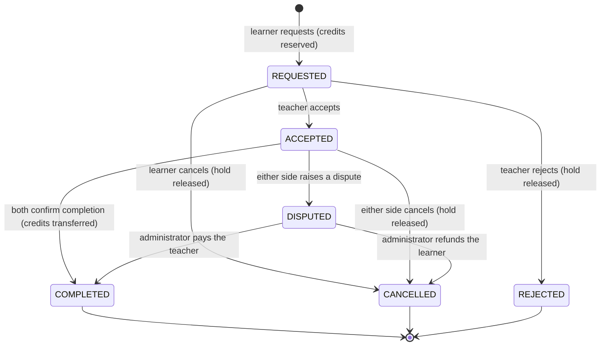

# SkillLoop – Database Design

* **DBMS:** MySQL Community Server 8.0.46 (InnoDB), localhost:3306
* **Schema:** `skillloop`, charset `utf8mb4`, collation `utf8mb4_0900_ai_ci`
* **JDBC URL:** `jdbc:mysql://localhost:3306/skillloop`
* **Driver:** `com.mysql.cj.jdbc.Driver` (Connector/J 9.2.0, resolved by Maven)
* **Scripts:** [`schema.sql`](../src/main/resources/db/schema.sql) (302 lines),
  [`views.sql`](../src/main/resources/db/views.sql) (11 views),
  [`seed.sql`](../src/main/resources/db/seed.sql) (optional demo data)
* **Diagram:** [`ER_DIAGRAM.md`](ER_DIAGRAM.md)

---

## 1. Design goals

1. **One authoritative row per fact.** A student's spendable credits live in exactly one row
   (`wallets`), and every change to it is mirrored by an immutable row in `credit_transactions`
   that can be replayed like a bank statement.
2. **Re-runnable scripts.** Every object is created with `CREATE … IF NOT EXISTS` / `CREATE OR
   REPLACE`, and no script contains `DROP`, `TRUNCATE` or `DELETE`. Running `DbSetupTool --init`
   against an existing, populated database changes nothing.
3. **Constraints in the database, not only in Java.** `CHECK`, `UNIQUE` and `FOREIGN KEY`
   constraints back up the service rules so that a bug (or a direct SQL client) cannot corrupt the
   data.
4. **Safe concurrency.** All money movement happens inside a single InnoDB transaction with
   `SELECT … FOR UPDATE` row locks taken in a deterministic order.

---

## 2. Normalisation

| Normal form | How it is satisfied |
| --- | --- |
| **1NF** | Every column is atomic (no comma-separated lists, no repeating groups). Multi-valued facts are separate tables: `student_skills`, `group_participants`, `student_achievements`. |
| **2NF** | Every table has a single-column surrogate primary key (`BIGINT AUTO_INCREMENT`) or – for the pure link tables – a composite key; all non-key columns depend on the whole key. `student_skills` stores `proficiency`/`description` per (student, skill, type), never per student. |
| **3NF** | No transitive dependencies. A session stores `teacher_id`, `learner_id`, `skill_id` – not the teacher's name or the skill's name. Derived values (average rating, number of taught sessions, ranking score) are **never** stored in `students`; they are computed by `views.sql` and by aggregate queries. The two denormalised columns that do exist are deliberate: `wallets.balance`/`held_credits` (a running total that must be lockable) and `credit_transactions.balance_after`/`held_after` (an audit snapshot of that total at the time of the movement). |

### Deliberate, documented exceptions

| Column | Why it is stored |
| --- | --- |
| `wallets.balance`, `wallets.held_credits` | A credit transfer needs a single row to lock and update; recomputing the sum on every transfer would be slower and would not give InnoDB a lock target. Correctness is guaranteed by the transaction and by `balance_after` in the ledger. |
| `credit_transactions.balance_after`, `held_after` | Audit snapshot. Without it, a disputed balance could not be reconstructed after the fact. |
| `learning_sessions.credit_cost` | The price at booking time. If the policy rate ever changed, historical sessions keep the price that both parties agreed to. |
| Counter caches on `skills` (`teachers_offering`, `learners_wanting`, `completed_sessions`) | Read-only columns filled by correlated subqueries in the DAO; they feed the "popular skills" lists. |

---

## 3. Table specification

### 3.1 `students`

| Column | Type | Rules |
| --- | --- | --- |
| `student_id` | `BIGINT AUTO_INCREMENT` | PK |
| `full_name` | `VARCHAR(120)` | `CHECK (CHAR_LENGTH(TRIM(full_name)) >= 2)` |
| `email` | `VARCHAR(190)` | `UNIQUE`, `CHECK (email LIKE '%_@_%._%')`, stored lower case |
| `password_hash` | `VARCHAR(72)` | BCrypt `$2a$12$…` (60 chars, 72-byte cap) |
| `department` | `VARCHAR(100)` | |
| `semester` | `INT` | `CHECK (semester BETWEEN 1 AND 12)` |
| `bio` | `VARCHAR(500)` | nullable |
| `role` | `ENUM('STUDENT','ADMIN')` | default `STUDENT` – registration can never create an administrator |
| `account_status` | `ENUM('ACTIVE','SUSPENDED','INACTIVE')` | default `ACTIVE` |
| `created_at`, `updated_at` | `TIMESTAMP` | `updated_at` is maintained by MySQL |

Indexes: `idx_students_role (role, account_status)`, `idx_students_dept (department)`.

### 3.2 `skills` and `student_skills`

The catalogue is shared (`skills.skill_name` is `UNIQUE`), the M:N relationship is
`student_skills` with `skill_type ∈ {OFFER, LEARN}` and
`proficiency_level ∈ {BEGINNER, INTERMEDIATE, ADVANCED}`.
`UNIQUE (student_id, skill_id, skill_type)` prevents duplicate listings; `is_active` supports
"deactivate instead of delete" so historical sessions and reviews stay valid.

### 3.3 `wallets`

`UNIQUE (student_id)` makes it a true 1:1 relationship.
`CHECK (balance >= 0)` and `CHECK (held_credits >= 0)` are the last line of defence against a
negative balance. Interpretation:

```text
spendable  = balance
reserved   = held_credits      (pending, not yet completed bookings)
total owned= balance + held_credits
```

### 3.4 `learning_sessions`

The heart of the application. Status lifecycle:



Guards in the schema: `CHECK (teacher_id <> learner_id)`, `CHECK (end_time > start_time)`,
`CHECK (duration_minutes IN (30,45,60,90,120))`, `CHECK (credit_cost >= 0)`, plus
`teacher_confirmation` / `learner_confirmation` for the two-sided verification.

### 3.5 `credit_transactions` (append-only ledger)

| Type | `amount` | `held_amount` | When |
| --- | --- | --- | --- |
| `STARTER_GRANT` | `+N` | 0 | once per student, reference `STARTER:<studentId>` |
| `HOLD` | 0 | `+cost` | when a session is requested |
| `RELEASE` | 0 | `-cost` | rejection, cancellation, refund |
| `SPEND` | `-cost` | 0 | settlement (learner) |
| `EARN` | `+cost` | 0 | settlement (teacher) |
| `REFUND` | `+cost` | 0 | administrator reverses a payment that had already been made |
| `ADMIN_ADJUSTMENT` | `±N` | 0 | audited correction, `created_by = adminId` |
| `GROUP_EARNING` | `+N` | 0 | group-session payout per learner |

`UNIQUE (txn_reference)` is the idempotency key: `settleSession` aborts (as a no-op) when
`SPEND:<sessionId>` or `EARN:<sessionId>` already exists, so a session can never be paid twice –
even if two users press "confirm" in the same millisecond.

### 3.6 Remaining tables

`availability_slots` (published teaching windows, `AVAILABLE → BOOKED/BLOCKED`, optional link to a
session), `reviews` (`UNIQUE (session_id, reviewer_id)`, rating 1–5), `notifications`,
`learning_resources`, `group_sessions` / `group_participants` (capacity 2–25,
`UNIQUE (group_id, student_id)`), `achievements` / `student_achievements` (composite PK makes
awards idempotent), `admin_audit_events`.

---

## 4. Transaction design

### 4.1 Atomic registration

```text
BEGIN
  INSERT students (…, password_hash = BCrypt(...), role = 'STUDENT')
  INSERT wallets (student_id = LAST_INSERT_ID(), balance = 0, held_credits = 0)
  [if enabled] UPDATE wallets SET balance = balance + starter
  [if enabled] INSERT credit_transactions (STARTER:<studentId>, balance_after)
COMMIT   -- any exception => ROLLBACK, neither student nor wallet exists
```

### 4.2 Settlement of a completed session (`CreditService.settleSession`, 11 steps)

```text
BEGIN
 1. SELECT * FROM learning_sessions WHERE session_id = ? FOR UPDATE   -- serialize both confirmations
 2. verify status ∈ {ACCEPTED, DISPUTED} and both confirmation flags
 3. verify both participants exist and are ACTIVE
 4. idempotency: SELECT 1 FROM credit_transactions WHERE txn_reference IN ('SPEND:id','EARN:id')
 5. SELECT … FROM wallets WHERE student_id IN (min,max) FOR UPDATE     -- deterministic lock order
 6. verify held_credits >= credit_cost
 7. release the reservation, then debit the learner  (applyDelta)
 8. credit the teacher
 9. INSERT two ledger rows (SPEND:<id>, EARN:<id>) with balance_after snapshots
10. UPDATE learning_sessions SET status='COMPLETED', settled_at=NOW()
    + idempotent achievement evaluation
11. INSERT two notifications
COMMIT    -- any exception => ROLLBACK: the credits stay reserved, nothing is lost
```

Wallet rows are always locked in ascending `student_id` order, which makes deadlocks between two
simultaneous settlements structurally impossible.

### 4.3 Isolation and locking

| Setting | Value | Reason |
| --- | --- | --- |
| Engine | InnoDB | Row-level locks, transactions, foreign keys |
| Isolation | `REPEATABLE READ` (MySQL default) | Consistent reads inside a transaction; `FOR UPDATE` reads the latest committed row |
| Row locks | `SELECT … FOR UPDATE` on `learning_sessions`, `wallets`, `availability_slots`, `group_sessions` | Serialise concurrent settles, enrolments and bookings |
| Lost updates | prevented by `UPDATE wallets SET balance = balance + ?` (atomic in place) rather than read-modify-write in Java | |

---

## 5. Indexes

Every foreign key is indexed (InnoDB does this automatically) and the hot read paths are covered by
composite indexes:

| Index | Serves |
| --- | --- |
| `idx_students_role (role, account_status)` | administrator lookups, active-student counts |
| `idx_ss_lookup (skill_id, skill_type, is_active)` | "who teaches X" and "who wants to learn X" |
| `idx_session_teacher (teacher_id, session_status)`, `idx_session_learner (learner_id, session_status)` | my sessions / pending requests |
| `idx_session_start (start_time)` | upcoming sessions, overlap checks |
| `idx_slot_lookup (student_id, status, start_time)` | bookable slots of a teacher |
| `idx_txn_student (student_id, created_at)` | wallet history |
| `uq_txn_reference (txn_reference)` | idempotency of every credit movement |
| `idx_notification_student (student_id, is_read, created_at)` | inbox + unread badge |
| `idx_review_reviewee (reviewee_id, rating)` | average rating of a teacher |

---

## 6. Views (`views.sql`)

Eleven reporting views built with `JOIN`, `GROUP BY`, `HAVING`, aggregate functions and correlated
subqueries (MySQL does not allow subqueries in the `FROM` clause of a view, so every aggregate is
expressed as a correlated scalar subquery in the `SELECT` list):

| View | Purpose |
| --- | --- |
| `v_student_directory` | Students with their offer/wish counts |
| `v_teacher_ratings` | Average rating and review count per teacher |
| `v_teaching_stats` | Sessions, hours and distinct learners per teacher |
| `v_learning_stats` | Sessions and hours per learner |
| `v_session_details` | Human-readable session list (names, skill, status) |
| `v_wallet_summary` | Balance, reserved credits and lifetime earned/spent |
| `v_skill_demand` | Supply vs. demand per skill (uses `HAVING` for "in demand") |
| `v_leaderboard` | Contribution data used by the ranking formula |
| `v_monthly_credit_volume` | Monthly credits credited/debited (`GROUP BY` period, type) |
| `v_open_availability` | Bookable slots with the teacher's name |
| `v_group_session_overview` | Group sessions with enrolment counts |

Every DAO that reads a view falls back to an equivalent base-table query if the view is missing, so
the application also runs on a schema created before `views.sql` was applied.

---

## 7. Sample queries used by the application

```sql
-- Who can teach Java at intermediate level or better?
SELECT s.student_id, s.full_name, ss.proficiency_level
FROM student_skills ss
JOIN students s  ON s.student_id = ss.student_id
JOIN skills  sk  ON sk.skill_id  = ss.skill_id
WHERE sk.skill_name = 'Java'
  AND ss.skill_type = 'OFFER'
  AND ss.is_active = TRUE
  AND ss.proficiency_level IN ('INTERMEDIATE','ADVANCED')
  AND s.account_status = 'ACTIVE';

-- Skills where more people want to learn than can teach (HAVING)
SELECT sk.skill_name,
       SUM(ss.skill_type = 'LEARN') AS learners,
       SUM(ss.skill_type = 'OFFER') AS teachers
FROM skills sk
JOIN student_skills ss ON ss.skill_id = sk.skill_id
WHERE ss.is_active = TRUE
GROUP BY sk.skill_id, sk.skill_name
HAVING learners > teachers
ORDER BY learners - teachers DESC;

-- Wallet statement of one student
SELECT created_at, transaction_type, amount, held_amount,
       balance_after, held_after, description
FROM credit_transactions
WHERE student_id = ?
ORDER BY transaction_id DESC
LIMIT 50;
```

---

## 8. Database users and privileges

The application must **never** connect as `root`. `DbSetupTool` refuses to run with the root
account unless `SKILLLOOP_ALLOW_ROOT=YES` is set (it is only needed once, to create the database).

```sql
-- once, as root
CREATE DATABASE IF NOT EXISTS skillloop CHARACTER SET utf8mb4 COLLATE utf8mb4_0900_ai_ci;
CREATE USER IF NOT EXISTS 'skillloop_app'@'localhost' IDENTIFIED BY 'choose-a-strong-password';
GRANT SELECT, INSERT, UPDATE, DELETE ON skillloop.* TO 'skillloop_app'@'localhost';
FLUSH PRIVILEGES;
```

`skillloop_app` is what `application.properties` uses. It cannot create or drop tables, cannot read
other schemas and exists only on `localhost` – the MySQL port is never exposed to a network.

---

## 9. Backup and reset (explicit, never automatic)

```powershell
mysqldump -u root -p --routines --single-transaction skillloop > skillloop-backup.sql
mysql -u root -p skillloop < skillloop-backup.sql
```

The application and its tools never drop a table. If a fresh start is really wanted, the user does
it explicitly with their own SQL – the project scripts will not do it for them.
