# SkillLoop – Entity Relationship Diagram

Database: **MySQL 8.0.46**, schema `skillloop`, engine **InnoDB**, charset `utf8mb4`.
Source of truth: [`src/main/resources/db/schema.sql`](../src/main/resources/db/schema.sql).

---

## 1. Full ER diagram (15 tables)

```mermaid
erDiagram
    STUDENTS ||--|| WALLETS            : "owns exactly one"
    STUDENTS ||--o{ STUDENT_SKILLS     : "publishes offers and wishes"
    STUDENTS ||--o{ AVAILABILITY_SLOTS : "publishes free time"
    STUDENTS ||--o{ LEARNING_SESSIONS  : "teaches (teacher_id)"
    STUDENTS ||--o{ LEARNING_SESSIONS  : "learns (learner_id)"
    STUDENTS ||--o{ CREDIT_TRANSACTIONS: "ledger entries"
    STUDENTS ||--o{ NOTIFICATIONS      : "receives"
    STUDENTS ||--o{ REVIEWS            : "writes (reviewer_id)"
    STUDENTS ||--o{ REVIEWS            : "receives (reviewee_id)"
    STUDENTS ||--o{ LEARNING_RESOURCES : "shares"
    STUDENTS ||--o{ GROUP_SESSIONS     : "hosts"
    STUDENTS ||--o{ GROUP_PARTICIPANTS : "enrols"
    STUDENTS ||--o{ STUDENT_ACHIEVEMENTS : "earns"
    STUDENTS ||--o{ ADMIN_AUDIT_EVENTS : "performs privileged actions"

    SKILLS   ||--o{ STUDENT_SKILLS     : "is offered / wanted"
    SKILLS   ||--o{ LEARNING_SESSIONS  : "is taught"
    SKILLS   ||--o{ LEARNING_RESOURCES : "is documented by"
    SKILLS   ||--o{ GROUP_SESSIONS     : "is taught in"

    LEARNING_SESSIONS ||--o|  AVAILABILITY_SLOTS   : "may consume a slot"
    LEARNING_SESSIONS ||--o{  CREDIT_TRANSACTIONS  : "produces ledger rows"
    LEARNING_SESSIONS ||--o{  REVIEWS              : "is reviewed after completion"

    GROUP_SESSIONS    ||--o{  GROUP_PARTICIPANTS   : "has participants"
    ACHIEVEMENTS      ||--o{  STUDENT_ACHIEVEMENTS : "is awarded as"

    STUDENTS {
        BIGINT       student_id     PK
        VARCHAR(120) full_name
        VARCHAR(190) email          UK "unique, lower case"
        VARCHAR(72)  password_hash     "BCrypt, cost 12"
        VARCHAR(100) department
        INT          semester          "1..12"
        VARCHAR(500) bio
        ENUM         role              "STUDENT | ADMIN"
        ENUM         account_status    "ACTIVE | SUSPENDED | INACTIVE"
        TIMESTAMP    created_at
        TIMESTAMP    updated_at
    }

    SKILLS {
        BIGINT       skill_id    PK
        VARCHAR(100) skill_name  UK
        VARCHAR(60)  category
        VARCHAR(500) description
        TIMESTAMP    created_at
    }

    STUDENT_SKILLS {
        BIGINT       student_skill_id PK
        BIGINT       student_id       FK
        BIGINT       skill_id         FK
        ENUM         skill_type          "OFFER | LEARN"
        ENUM         proficiency_level   "BEGINNER | INTERMEDIATE | ADVANCED"
        VARCHAR(500) description
        BOOLEAN      is_active
        TIMESTAMP    created_at
    }

    WALLETS {
        BIGINT    wallet_id    PK
        BIGINT    student_id   FK "unique (1:1)"
        INT       balance         "spendable credits, CHECK >= 0"
        INT       held_credits    "reserved credits, CHECK >= 0"
        TIMESTAMP updated_at
    }

    LEARNING_SESSIONS {
        BIGINT       session_id   PK
        BIGINT       teacher_id   FK
        BIGINT       learner_id   FK "CHECK teacher_id <> learner_id"
        BIGINT       skill_id     FK
        BIGINT       slot_id      FK "nullable, ON DELETE SET NULL"
        DATETIME     start_time
        DATETIME     end_time
        INT          duration_minutes "30 | 45 | 60 | 90 | 120"
        INT          credit_cost
        ENUM         session_status   "REQUESTED | ACCEPTED | REJECTED | CANCELLED | COMPLETED | DISPUTED"
        BOOLEAN      teacher_confirmation
        BOOLEAN      learner_confirmation
        VARCHAR(500) learner_note
        VARCHAR(500) resolution_note
        BIGINT       resolved_by  FK "administrator"
        DATETIME     settled_at
        TIMESTAMP    created_at
    }

    AVAILABILITY_SLOTS {
        BIGINT    slot_id    PK
        BIGINT    student_id FK
        DATETIME  start_time
        DATETIME  end_time
        ENUM      status     "AVAILABLE | BOOKED | BLOCKED"
        BIGINT    session_id FK "nullable"
        TIMESTAMP created_at
    }

    CREDIT_TRANSACTIONS {
        BIGINT       transaction_id PK
        BIGINT       student_id     FK
        BIGINT       session_id     FK "nullable"
        INT          amount         "effect on balance"
        INT          held_amount    "effect on reservation"
        INT          balance_after
        INT          held_after
        ENUM         transaction_type "STARTER_GRANT | HOLD | RELEASE | SPEND | EARN | REFUND | ADMIN_ADJUSTMENT | GROUP_EARNING"
        VARCHAR(80)  txn_reference  UK "idempotency key"
        VARCHAR(255) description
        BIGINT       created_by     FK "administrator for adjustments"
        TIMESTAMP    created_at
    }

    REVIEWS {
        BIGINT        review_id   PK
        BIGINT        session_id  FK
        BIGINT        reviewer_id FK
        BIGINT        reviewee_id FK
        INT           rating         "1..5"
        VARCHAR(1000) comment
        TIMESTAMP     created_at
    }

    NOTIFICATIONS {
        BIGINT       notification_id PK
        BIGINT       student_id      FK
        VARCHAR(120) title
        VARCHAR(500) message
        ENUM         notification_type
        BOOLEAN      is_read
        TIMESTAMP    created_at
    }

    LEARNING_RESOURCES {
        BIGINT       resource_id  PK
        BIGINT       student_id   FK
        BIGINT       skill_id     FK
        VARCHAR(150) title
        VARCHAR(500) description
        VARCHAR(500) resource_url
        TIMESTAMP    created_at
    }

    GROUP_SESSIONS {
        BIGINT       group_id    PK
        BIGINT       teacher_id  FK
        BIGINT       skill_id    FK
        VARCHAR(150) title
        DATETIME     start_time
        DATETIME     end_time
        INT          capacity       "2..25"
        INT          credit_cost_per_learner
        ENUM         status         "OPEN | CLOSED | COMPLETED | CANCELLED"
        TIMESTAMP    created_at
    }

    GROUP_PARTICIPANTS {
        BIGINT    participant_id PK
        BIGINT    group_id       FK
        BIGINT    student_id     FK "UNIQUE (group_id, student_id)"
        ENUM      status         "JOINED | CANCELLED | COMPLETED"
        TIMESTAMP joined_at
    }

    ACHIEVEMENTS {
        BIGINT       achievement_id PK
        VARCHAR(40)  code           UK
        VARCHAR(80)  name
        VARCHAR(255) description
        VARCHAR(8)   icon
    }

    STUDENT_ACHIEVEMENTS {
        BIGINT    student_id     PK
        BIGINT    achievement_id PK
        TIMESTAMP awarded_at
    }

    ADMIN_AUDIT_EVENTS {
        BIGINT       event_id    PK
        BIGINT       admin_id    FK
        VARCHAR(60)  action
        VARCHAR(40)  target_type
        BIGINT       target_id
        VARCHAR(500) details
        TIMESTAMP    created_at
    }
```

---

## 2. Reading the cardinalities

| Relationship | Cardinality | Meaning |
| --- | --- | --- |
| Student → Wallet | 1 : 1 | `wallets.student_id` is `UNIQUE`; the row is created in the same transaction as the student, so no student can exist without a wallet. |
| Student → StudentSkill | 1 : N | A student lists many skills; `UNIQUE (student_id, skill_id, skill_type)` prevents publishing the same offer twice. |
| Skill → StudentSkill | 1 : N | The catalogue is shared; deleting a skill cascades its listings. |
| Student → LearningSession (teacher / learner) | 1 : N each | Two separate foreign keys; `CHECK (teacher_id <> learner_id)` forbids self-booking in the database itself. |
| LearningSession → AvailabilitySlot | N : 1 (optional) | A booking may consume a published slot; deleting the session sets the slot reference to `NULL`. |
| LearningSession → CreditTransaction | 1 : N | One completed session produces exactly two ledger rows (a `SPEND` for the learner and an `EARN` for the teacher), plus the `HOLD`/`RELEASE` pair during the request phase. |
| LearningSession → Review | 1 : 2 | `UNIQUE (session_id, reviewer_id)` allows exactly one review per participant and blocks duplicates. |
| GroupSession → GroupParticipant | 1 : N | Capacity is enforced both in the service and by `CHECK (capacity BETWEEN 2 AND 25)`. |
| Achievement → StudentAchievement | 1 : N | Composite primary key `(student_id, achievement_id)` makes awards idempotent. |

---

## 3. Integrity rules that the diagram encodes

* **No orphan credits.** Every credit movement belongs to a student and carries a unique
  `txn_reference` (`STARTER:<id>`, `HOLD:<session>`, `SPEND:<session>`, `EARN:<session>`,
  `REFUND:<session>:<student>`, `ADJ:<student>:<ts>`, `GROUP:…`). This is the idempotency key of
  the wallet: a session that is settled twice is rejected by the unique index.
* **Money cannot go negative.** `CHECK (balance >= 0)` and `CHECK (held_credits >= 0)` give a
  database-level guarantee in addition to the service checks.
* **Only legal sessions.** `CHECK (end_time > start_time)`,
  `CHECK (duration_minutes IN (30,45,60,90,120))` and `CHECK (teacher_id <> learner_id)`.
* **Only legal reviews.** `CHECK (rating BETWEEN 1 AND 5)` and
  `CHECK (reviewer_id <> reviewee_id)`.
* **Cascades are intentional.** Student-owned data (`wallets`, `student_skills`,
  `availability_slots`, `credit_transactions`, `reviews`, `notifications`, `learning_resources`,
  `group_participants`, `student_achievements`) cascades on delete; references that must stay
  readable for auditing (`learning_sessions`, `group_sessions`, `admin_audit_events`) do not.
