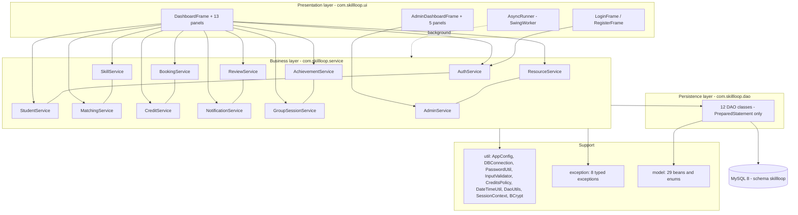
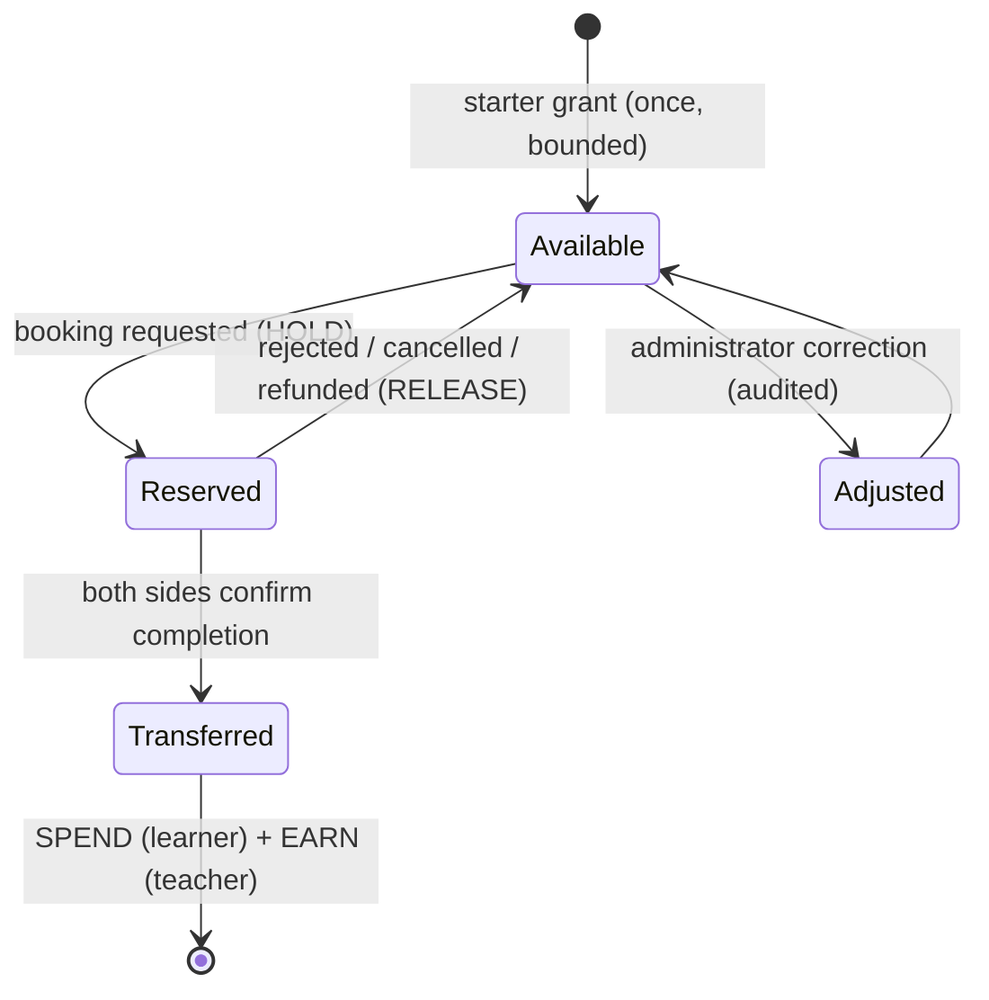

# SkillLoop – A Credit-Based Peer Learning Platform

## Project Report

| Field | Details |
| --- | --- |
| **Title** | SkillLoop – A Credit-Based Peer Learning Platform |
| **Domain** | Peer-to-peer skill exchange with a time-credit economy |
| **Type** | Java desktop application (not a web application) |
| **Language** | Java (JDK 24 language level) |
| **UI technology** | Java Swing (FlatLaf), Event Dispatch Thread discipline |
| **Persistence** | JDBC 4.3 + MySQL 8.0.46 (Connector/J 9.2.0) |
| **Build & tests** | Apache Maven, JUnit 5 (Jupiter 5.11.4) |
| **IDE** | Eclipse IDE for Java Developers |
| **Database** | `skillloop` on `localhost:3306`, 15 tables, 11 views |
| **Size** | 104 main classes (≈14,000 LOC), 21 test classes (≈2,500 LOC), 675 lines of SQL |
| **Report date** | 2026-10-25 |

---

## 1. Abstract

SkillLoop is a desktop application in which students of a college teach each other skills and pay
each other in **time-credits** instead of money. Teaching a 60-minute session earns 20 credits, a
30-minute session earns 10 credits, and learning costs the same. A new account receives a one-time,
bounded starter grant, so nobody starts at zero; every later credit movement must be earned by
teaching, by an audited administrator correction, or by a refund.

The system combines a full booking lifecycle (request → accept → two-sided completion verification
→ settlement) with a secure wallet whose ledger is append-only and idempotent, a transparent
matching algorithm that prefers reciprocal partners, a reputation system (reviews, achievements,
leaderboard), community features (resources, group sessions, notifications) and an administrator
console with a complete audit trail.

The application is built as a strict four-layer architecture (`ui → service → dao → JDBC → MySQL`),
contains no SQL outside the DAO layer, no credential in the source tree, and never drops or
truncates a table.

---

## 2. Introduction

### 2.1 Problem

Colleges are full of complementary skills: one student writes Java and needs a poster designed,
another designs posters and wants to learn to code. Today this exchange happens over chat groups
with no record, no scheduling, no quality control and no incentive to keep contributing. Tutoring
marketplaces solve it with money, which is not appropriate inside a campus community.

### 2.2 Proposed solution

SkillLoop introduces a **closed-loop credit economy**:

* Time is the currency, priced by the documented policy `credits = duration / 60 × 20`.
* Credits are created only by verified teaching (or by a controlled, audited grant/adjustment), so
  the economy cannot be inflated by a button click.
* Every movement is a row in an append-only ledger with an idempotency key, so a session can never
  be paid twice and a balance can never go negative.
* Reputation comes from **verified** activity (completed sessions, distinct learners, ratings) – not
  from the wallet balance, so the leaderboard measures contribution, not wealth.

### 2.3 Objectives

1. Provide secure registration/login with modern password hashing and atomic wallet creation.
2. Let students publish what they can teach and what they want to learn, with proficiency levels.
3. Recommend partners through an explainable scoring model that favours reciprocity.
4. Support the complete booking lifecycle with an explicit state machine and legal transitions only.
5. Guarantee a safe credit wallet: reservation, settlement, refunds, history, no negative balances.
6. Build a reputation layer (reviews, achievements, leaderboard, analytics).
7. Give administrators moderation, dispute resolution and credit-correction tools with an audit
   trail, while enforcing authorization in the service layer.
8. Keep the codebase maintainable: layered packages, one responsibility per class, typed exceptions,
   no SQL in the UI, automated tests.

### 2.4 Scope

**In scope:** desktop application for one campus, MySQL schema, seed data, reporting views,
maintenance tools, automated tests, full documentation.

**Out of scope:** payments in real currency, video conferencing, mobile clients, e-mail delivery,
multi-tenant deployment, and any web front-end.

---

## 3. System analysis

### 3.1 Existing system and its limitations

| Existing approach | Limitation |
| --- | --- |
| Informal chat groups / notice boards | No scheduling, no record, no reputation, no incentive |
| Paid tutoring platforms | Money-based, unsuitable for students; no reciprocity |
| Learning management systems | One-directional (teacher → class), no peer exchange, no economy |
| Barter spreadsheets | Manual, error-prone, no enforcement, no audit |

### 3.2 Feasibility

| Feasibility | Assessment |
| --- | --- |
| Technical | Core Java + Swing + JDBC + MySQL are part of the curriculum; the driver (Connector/J) is a single Maven dependency; no exotic infrastructure. |
| Operational | Everything runs on one Windows machine with a local MySQL instance; setup is scripted (`DbSetupTool`). |
| Economic | Zero licensing cost – JDK, Eclipse, MySQL Community, Maven and JUnit are free. |
| Schedule | Delivered in phases (configuration → schema → models → DAO → services → UI → tools → tests → docs), each leaving the project compilable. |

### 3.3 Requirements

**Functional**

| ID | Requirement |
| --- | --- |
| FR-1 | A visitor registers with name, e-mail, department, semester and a strength-checked password; the wallet is created in the same transaction. |
| FR-2 | A registered user logs in; suspended accounts are refused; no default administrator exists. |
| FR-3 | A student manages her profile and her skill listings (offer / want) with proficiency. |
| FR-4 | Students search and filter the shared skill catalogue. |
| FR-5 | The system recommends partners, ranking reciprocal matches first and explaining the score. |
| FR-6 | A student publishes availability slots. |
| FR-7 | A learner books a session (30/45/60/90/120 minutes) if the teacher offers the skill, the time is free and the credits are available. |
| FR-8 | The teacher accepts or rejects; either side may cancel; a dispute can be raised. |
| FR-9 | Completion requires confirmation from **both** sides; settlement then transfers the credits. |
| FR-10 | Each participant may review the other once (1–5 stars). |
| FR-11 | The wallet shows balance, reserved credits and the complete ledger. |
| FR-12 | Achievements are awarded automatically for verified contributions. |
| FR-13 | The leaderboard ranks verified contribution, not balance; progress analytics show hours and partners. |
| FR-14 | Students share learning resources per skill. |
| FR-15 | A teacher hosts a group session; learners enrol and pay per seat. |
| FR-16 | Notifications are generated for every relevant event. |
| FR-17 | Administrators see statistics, moderate accounts and listings, resolve disputes, adjust credits and read the audit log. |

**Non-functional**

| ID | Requirement | Realisation |
| --- | --- | --- |
| NFR-1 | Security | BCrypt cost 12, `PreparedStatement` only, no SQL in UI, credentials outside the code, authorization in the service layer, mandatory audit trail |
| NFR-2 | Data integrity | One transaction per money movement, `SELECT … FOR UPDATE` locks in a deterministic order, `CHECK`/`UNIQUE`/`FK` constraints |
| NFR-3 | Idempotency | Unique ledger references make double settlement impossible |
| NFR-4 | Responsiveness | All database work runs on a `SwingWorker` (`AsyncRunner`); the EDT is never blocked |
| NFR-5 | Portability | Standard Maven project, importable in Eclipse; only JDK 24 + MySQL 8 required |
| NFR-6 | Safety of scripts | No `DROP`/`TRUNCATE`/`DELETE` in any shipped SQL script |
| NFR-7 | Maintainability | Layered packages, typed exceptions, ~100 small classes, automated tests |
| NFR-8 | Usability | Consistent theme, dialogs instead of stack traces, empty states instead of hard-coded numbers |

---

## 4. System design

### 4.1 Architecture



Rules that are enforced mechanically, not by convention:

* No class in `com.skillloop.ui` contains SQL (verified by `SourceSecurityTest`).
* No class outside `com.skillloop.dao` opens a `java.sql.Connection` for application data.
* No service returns a `SQLException`; failures become typed exceptions that the UI converts into
  dialogs.

### 4.2 Module responsibilities

| Module | Responsibility |
| --- | --- |
| `AuthService` | Registration (atomic with wallet + starter grant), login, password change, role changes |
| `StudentService` | Profile, progress analytics, leaderboard and the transparent ranking formula |
| `SkillService` | Catalogue, search, listings (add / update / deactivate) |
| `MatchingService` | Weighted candidate scoring and reciprocal-partner detection |
| `BookingService` | Availability, booking rules, state machine, two-sided completion, disputes |
| `CreditService` | Reservations, settlement, refunds, adjustments, group payouts, ledger queries |
| `ReviewService` | Eligibility, duplicate prevention, rating aggregation |
| `NotificationService` | In-app inbox for every event |
| `AchievementService` | Idempotent badge evaluation after each settlement |
| `GroupSessionService` | Group sessions, enrolment, capacity, payout |
| `ResourceService` | Shared learning material |
| `AdminService` | Statistics, moderation, disputes, credit corrections, audit log |

### 4.3 The matching algorithm (transparent and explainable)

Every candidate teacher is scored out of 100; the UI shows the breakdown next to each result:

| Component | Max points | Rule |
| --- | --- | --- |
| Reciprocity | 30 | The candidate wants to learn something I offer **and** offers something I want |
| Proficiency | 20 | Advanced 20 / Intermediate 14 / Beginner 8 |
| Availability | 15 | Number of bookable slots in the next days (scaled) |
| Rating | 15 | `average rating / 5 × 15`; a teacher without reviews gets the neutral 7.5 |
| Experience | 10 | Completed sessions as a teacher (scaled) |
| Interest | 10 | The candidate explicitly listed the requested skill as *wanted to learn* (mutual interest) |
| **Total** | **100** | Reciprocal partners therefore surface first, exactly as intended |

The formula lives in one place (`MatchingService`) and is unit-tested against its documentation
(`MatchingWeightsTest`), so the score shown on screen and the score used for ranking cannot drift
apart.

### 4.4 The credit lifecycle



Pricing is `duration / 60 × 20` credits per hour: 30 min = 10, 45 min = 15, 60 min = 20,
90 min = 30, 120 min = 40. Only these five durations are accepted (`CHECK` constraint and
`InputValidator`).

### 4.5 Leaderboard formula

```text
score = min(teaching_sessions × 8, 40)      // verified sessions, capped
      + min(teaching_hours × 2, 20)         // hours taught, capped
      + min(distinct_learners × 3, 15)      // breadth of help, capped
      + avg_rating × 3                      // quality (0..15)
      + min(credits_earned × 0.05, 10)      // small bonus for volume, capped
      = max 100
```

The wallet balance is deliberately **not** part of the formula, so holding credits never buys a
rank. `LeaderboardScoreTest` pins the formula to its documentation (61.0 for the reference entry).

---

## 5. Implementation

### 5.1 Technology decisions

| Decision | Reason |
| --- | --- |
| Java Swing (not a web UI) | The brief asks for a Core-Java desktop application; Swing needs no server, no browser and runs offline on a lab machine. |
| JDBC directly (no ORM) | The project is about SQL and transactions; hand-written `PreparedStatement` code keeps every query explicit and reviewable. |
| MySQL 8 / InnoDB | Row-level locks, `CHECK` constraints, window-ready SQL and a single local instance. |
| BCrypt (cost 12), vendored | A well-known, dependency-free KDF; the reference implementation is vendored into `com.skillloop.util.BCrypt` with a provenance note. |
| FlatLaf | A modern look and feel; the app falls back to Nimbus if the jar is missing. |
| JUnit 5 with `*IT` naming | A clean split between pure unit tests and database integration tests, one Maven profile apart. |

### 5.2 Concurrency and the Event Dispatch Thread

* Every screen is built and mutated on the EDT (`SwingUtilities.invokeLater` in `Main`).
* Every database call from the UI goes through `AsyncRunner.run(component, supplier, consumer)`,
  a `SwingWorker` wrapper; the supplier runs in the background, the consumer updates the widgets on
  the EDT. A busy cursor and disabled buttons prevent double clicks.
* Long transactions never touch the UI: the service completes and returns a model object, then the
  consumer paints it.

### 5.3 Security implementation

| Concern | Implementation |
| --- | --- |
| Password storage | BCrypt cost 12 with a random salt; `PasswordUtil.validateStrength` enforces length, letters and digits before hashing; `verify` never throws on malformed input. |
| SQL injection | 100 % `PreparedStatement`; no string concatenation of user input into SQL anywhere (static test). |
| Credentials | Read from `config/application.properties` (git-ignored) or `SKILLLOOP_DB_*` environment variables; `maskedDescription()` is the only place the connection is printed. |
| Least privilege | The application connects as `skillloop_app`, never as `root`; `DbSetupTool` refuses root unless explicitly allowed. |
| Authorization | `AdminService.requireAdmin(actorId)` re-loads the actor from the database and checks `role = ADMIN` on every privileged call – the UI check is convenience only. |
| Default accounts | The seed data contains only `STUDENT` accounts; the first administrator is created interactively by `AdminBootstrapTool` with a hidden password prompt. |
| Audit | Every privileged action writes `admin_audit_events(action, target_type, target_id, details)`. |

### 5.4 Error handling

`SkillLoopException` is the root of eight typed exceptions
(`ValidationException`, `AuthenticationException`, `AuthorizationException`, `NotFoundException`,
`DuplicateResourceException`, `InsufficientCreditsException`, `BookingException`,
`DatabaseException`). The UI catches them centrally and shows a dialog with the exception message,
so a user never sees a stack trace, and the service layer never swallows a failure silently.

### 5.5 Screens

| Screen | Purpose |
| --- | --- |
| Login / Register | Entry points; registration validates everything at once and shows all problems |
| Dashboard (Home) | Wallet summary, upcoming sessions, progress analytics, achievements |
| Profile | Name, department, semester, bio, password change |
| Skills | Catalogue search/filter plus "my skills" listings |
| Explore | Browse teachers for a chosen skill |
| Matching | Ranked reciprocal and one-way partners with the score breakdown |
| Sessions | Requests, upcoming, history; accept/reject/cancel/confirm/dispute |
| Wallet | Balance, reserved credits and the full ledger |
| Reviews | Reviewable sessions and reviews received |
| Resources | Shared material per skill |
| Notifications | Inbox with unread counter |
| Leaderboard | Contribution ranking |
| Groups | Open group sessions, join/create/complete |
| Administrator console | Overview, students, listings, disputes, credits, audit log |

> **Screenshots:** no screenshot is included in this submission because the authoring environment
> has no display and no running MySQL instance; capturing a fake image would contradict the rule
> "no fabricated results". Every screen listed above is fully implemented and can be captured on the
> target machine by following [`SETUP_GUIDE.md`](SETUP_GUIDE.md) §8.

---

## 6. Testing

Summary (full detail in [`TESTING_REPORT.md`](TESTING_REPORT.md)):

| Metric | Value |
| --- | --- |
| Test classes | 20 (8 unit + 12 integration) |
| Test methods | 100 (39 unit + 61 integration) |
| Unit tests executed in the authoring sandbox | 39 / 39 passed |
| Integration tests executed | 0 – skipped, the sandbox has no MySQL server |
| Static compile check | 104 main classes + 21 test classes compile with 0 errors (ECJ 24) |

Highlights: atomic registration, no self-booking, overlap prevention, two-sided completion,
idempotent settlement, no negative balances, duplicate-review prevention, service-layer
authorization, audited moderation, non-destructive SQL scripts, and static guards that fail the
build if a raw `Statement` or SQL-in-UI ever appears again.

---

## 7. Results

* A complete desktop application: 104 classes, 15 database tables, 11 reporting views, 14 screens
  plus 5 administrator screens, 4 maintenance tools.
* A credit economy that is safe by construction: reservations, idempotent settlement, append-only
  ledger, capped grants, audited adjustments, database-level `CHECK (balance >= 0)`.
* A transparent ranking model whose numbers are documented, displayed and unit-tested.
* A test suite of 100 tests that separates pure logic from database behaviour and never touches
  data it did not create.
* Full documentation: report, ER diagram, use cases, class diagram, database design, testing report,
  setup guide.

---

## 8. Conclusion

SkillLoop shows that a peer-learning community can be coordinated without money: a closed loop of
time-credits, enforced by database transactions and a transparent ledger, gives students a reason to
teach and a fair way to learn. The project deliberately keeps the hard parts visible – the state
machine, the settlement transaction, the lock ordering, the idempotency keys – instead of hiding
them in a framework, which makes the behaviour explainable in a viva and verifiable in tests.

The parts that could not be executed in the authoring sandbox (everything that needs a live MySQL
server and a display) are documented as such rather than claimed as done; the setup guide and the
`db-tests` Maven profile close that gap in minutes on the target machine.

---

## 9. Future enhancements

1. E-mail / push notifications outside the application.
2. Calendar export (ICS) and reminder jobs.
3. Skill endorsement tests (a short quiz before an "Advanced" listing is published).
4. Credit expiry or a small inactivity decay to keep the economy circulating.
5. Rich analytics dashboard (charts) built on the existing views.
6. Containerised MySQL for one-command setup, and a headless UI test suite (AssertJ-Swing).

---

## 10. References

1. Oracle, *The Java Tutorials – JDBC Database Access*,
   https://docs.oracle.com/javase/tutorial/jdbc/
2. Oracle, *Java Swing Tutorial*, https://docs.oracle.com/javase/tutorial/uiswing/
3. MySQL 8.0 Reference Manual – InnoDB Locking and Transaction Model,
   https://dev.mysql.com/doc/refman/8.0/en/innodb-locking-transaction-model.html
4. MySQL 8.0 Reference Manual – `CREATE VIEW` restrictions (no subquery in `FROM`),
   https://dev.mysql.com/doc/refman/8.0/en/create-view.html
5. Provos & Mazières, *A Future-Adaptive Password Scheme* (BCrypt), USENIX 1999
6. JUnit 5 User Guide, https://junit.org/junit5/docs/current/user-guide/
7. Apache Maven – Surefire Plugin and `exec-maven-plugin` documentation,
   https://maven.apache.org/plugins/

---

## Appendix A – Source inventory

| Package | Files | LOC | Content |
| --- | --- | ---: | ---: |
| `com.skillloop.model` | 29 | 2,394 | Beans and enums (one per table plus result objects) |
| `com.skillloop.dao` | 12 | 2,373 | All SQL, all `PreparedStatement` |
| `com.skillloop.service` | 12 | 2,455 | Business rules and transactions |
| `com.skillloop.ui` | 29 | 4,463 | Swing screens, theme, `AsyncRunner`, `Main` |
| `com.skillloop.util` | 9 | 1,738 | Configuration, connection, hashing, policy, helpers |
| `com.skillloop.exception` | 9 | 137 | Typed exceptions |
| `com.skillloop.tools` | 4 | 460 | Connection test, setup, admin bootstrap, script runner |
| **Total** | **104** | **14,020** | |
| `src/test/java` | 21 | 2,520 | 20 test classes + `TestEnvironment` |
| `src/main/resources/db` | 3 | 675 | `schema.sql` (302), `views.sql` (217), `seed.sql` (156) |

## Appendix B – Command summary

```powershell
mvn clean package                                       # build + unit tests
mvn test -P db-tests                                    # unit + database tests
mvn -q exec:java -Dexec.mainClass=com.skillloop.Main                                  # run
mvn -q exec:java -Dexec.mainClass=com.skillloop.tools.ConnectionTest                   # connectivity
mvn -q exec:java -Dexec.mainClass=com.skillloop.tools.DbSetupTool -Dexec.args="--all"  # schema + views + demo data
mvn -q exec:java -Dexec.mainClass=com.skillloop.tools.AdminBootstrapTool               # first administrator
```
