# SkillLoop – Use-Case Diagram and Use-Case Descriptions

Mermaid has no native use-case element, so the actors are drawn as circles and the use cases as
stadiums inside the system boundary – the standard mapping of a UML use-case diagram.

---

## 1. Use-case diagram

```mermaid
flowchart LR
    S((Student))
    A((Administrator))
    G((Guest))

    subgraph SYS["SkillLoop – Credit-Based Peer Learning Platform"]
        direction TB

        subgraph AUTH["Authentication & profile"]
            UC1([UC-01 Register and create wallet])
            UC2([UC-02 Log in / log out])
            UC3([UC-03 Manage profile])
            UC4([UC-04 Change password])
        end

        subgraph SKILLS["Skills & matching"]
            UC5([UC-05 Browse / search skill catalogue])
            UC6([UC-06 Manage my skill listings])
            UC7([UC-07 Find matching partners])
            UC8([UC-08 Publish availability])
        end

        subgraph BOOK["Booking & completion"]
            UC9([UC-09 Request a session])
            UC10([UC-10 Accept / reject a request])
            UC11([UC-11 Cancel a booking])
            UC12([UC-12 Confirm completion])
            UC13([UC-13 Raise a dispute])
        end

        subgraph VALUE["Credit wallet & reputation"]
            UC14([UC-14 View wallet and ledger])
            UC15([UC-15 Review a partner])
            UC16([UC-16 Earn achievements])
            UC17([UC-17 View leaderboard])
            UC18([UC-18 View progress analytics])
        end

        subgraph MORE["Community"]
            UC19([UC-19 Share learning resources])
            UC20([UC-20 Host / join a group session])
            UC21([UC-21 Read notifications])
        end

        subgraph ADMIN["Administration"]
            UC22([UC-22 View dashboard statistics])
            UC23([UC-23 Moderate accounts])
            UC24([UC-24 Moderate listings])
            UC25([UC-25 Resolve a dispute])
            UC26([UC-26 Adjust credits])
            UC27([UC-27 Inspect the audit log])
        end
    end

    G --- UC1
    G --- UC2

    S --- UC2
    S --- UC3
    S --- UC4
    S --- UC5
    S --- UC6
    S --- UC7
    S --- UC8
    S --- UC9
    S --- UC10
    S --- UC11
    S --- UC12
    S --- UC13
    S --- UC14
    S --- UC15
    S --- UC16
    S --- UC17
    S --- UC18
    S --- UC19
    S --- UC20
    S --- UC21

    A --- UC2
    A --- UC22
    A --- UC23
    A --- UC24
    A --- UC25
    A --- UC26
    A --- UC27
    A -.->|"also a student"| UC5
```

---

## 2. Actors

| Actor | Description |
| --- | --- |
| **Guest** | Anybody who has not logged in yet. May register or log in. |
| **Student** | A registered user. May teach (credits in), learn (credits out), review, publish resources and join group sessions. |
| **Administrator** | A student with `role = ADMIN`. Owns the moderation, dispute and credit-correction use cases in addition to every student use case. The first administrator is created by `AdminBootstrapTool`; the role is never granted by the seed data. |

---

## 3. Use-case descriptions

### UC-01 Register and create wallet

| Field | Content |
| --- | --- |
| Actor | Guest |
| Precondition | The e-mail address is not yet registered. |
| Main flow | 1. Enter full name, e-mail, department, semester, password and confirmation. 2. The service validates every field and collects **all** problems at once. 3. The password is hashed with BCrypt (cost 12). 4. **In one transaction**: insert `students`, insert `wallets` (balance 0), optionally insert the one-time `STARTER_GRANT` ledger row. 5. The new account has `role = STUDENT`. |
| Alternative | 3a. Duplicate e-mail → `DuplicateResourceException`, dialog, nothing written. 4a. Any failure → rollback, no student and no wallet exist. |
| Post-condition | A student with a wallet exists; the starter grant (if enabled) appears as the first ledger entry. |
| Implemented by | `AuthService.register`, `StudentDAO.insert`, `WalletDAO`, `CreditService.grantStarterGrant` |
| Tests | `AuthIT` (registration, duplicate, weak password, atomicity), `DatabaseScriptTest` |

### UC-02 Log in / log out

| Field | Content |
| --- | --- |
| Actor | Guest / Student / Administrator |
| Main flow | 1. Enter e-mail and password. 2. Look up the account (case-insensitive e-mail). 3. Verify the BCrypt hash. 4. Check `account_status = ACTIVE`. 5. Load the role and open the student dashboard or the administrator console. |
| Alternative | 2a. Unknown e-mail → generic "e-mail or password is incorrect" (no user enumeration). 4a. Suspended → `AuthenticationException`, login refused. |
| Implemented by | `AuthService.login` |
| Tests | `AuthIT` |

### UC-07 Find matching partners

| Field | Content |
| --- | --- |
| Actor | Student |
| Main flow | 1. Optionally pick a skill and a minimum proficiency. 2. The service scores every candidate teacher with the transparent formula (reciprocity 30 + proficiency ≤ 20 + availability 15 + rating 15 + experience 10 + interest 10 = max 100). 3. Reciprocal partners (they offer what I want **and** want what I offer) are listed first; the score breakdown is displayed next to each result. |
| Alternative | 2a. No candidate → empty-state message, never a hard-coded number. |
| Implemented by | `MatchingService.recommendTeachers`, `findReciprocalPartners` |
| Tests | `MatchingWeightsTest`, `SkillMatchingIT` |

### UC-09 Request a session

| Field | Content |
| --- | --- |
| Actor | Student (learner) |
| Precondition | The teacher actively offers the skill; the learner has enough spendable credits; the start time is at least 5 minutes in the future; neither participant has another session in the same window. |
| Main flow | 1. Choose teacher, skill, slot (optional), start time, duration ∈ {30, 45, 60, 90, 120}. 2. Cost = `duration / 60 × 20` credits. 3. **In one transaction**: create `learning_sessions` (`REQUESTED`), reserve the credits (`HOLD` ledger row, `held_credits += cost`), notify the teacher. |
| Alternative | Self-booking, overlap, unknown listing, insufficient funds, illegal duration → `BookingException`/`ValidationException`, transaction rolled back, no row and no hold. |
| Implemented by | `BookingService.requestBooking`, `CreditService.placeHold` |
| Tests | `BookingIT`, `CreditWalletIT` |

### UC-12 Confirm completion (two-sided verification)

| Field | Content |
| --- | --- |
| Actor | Student (teacher and learner) |
| Precondition | Status is `ACCEPTED` and the start time has passed. |
| Main flow | 1. The teacher confirms → `teacher_confirmation = TRUE`, status stays `ACCEPTED`, the partner is notified. 2. The learner confirms → `learner_confirmation = TRUE`. 3. **Settlement** (single transaction): lock the session row → lock both wallets in idempotency order → check the ledger references (`SPEND:<id>`, `EARN:<id>`) → release the reservation → debit the learner → credit the teacher → write both ledger rows → mark `COMPLETED` → evaluate achievements → notify both. |
| Alternative | Only one confirmation → nothing is paid. Already confirmed by the same side → `BookingException`. Any failure → rollback, the credits stay reserved. |
| Post-condition | The teacher's balance grew by the session cost, the learner's shrank by the same amount, two immutable ledger rows describe it. |
| Implemented by | `BookingService.confirmCompletion`, `CreditService.settleSession` |
| Tests | `BookingIT.completionRequiresBothSides`, `CreditWalletIT` |

### UC-13 / UC-25 Raise and resolve a dispute

| Field | Content |
| --- | --- |
| Actors | Student (participant) → Administrator |
| Main flow | Participant: describe the problem on an `ACCEPTED` session → status `DISPUTED`, the reservation stays on hold. Administrator: read both sides and resolve as **pay the teacher** (both confirmations are set and the ordinary settlement runs) or **refund the learner** (reservation released, or a `REFUND` ledger row when the session had already been paid). |
| Alternative | Non-participants cannot raise a dispute; the resolution is written to `resolution_note`, `resolved_by` and to the audit log. |
| Implemented by | `BookingService.raiseDispute`, `AdminService.resolveDispute` |
| Tests | `AdminIT` (both resolution directions), `CreditWalletIT` (refund) |

### UC-15 Review a partner

| Field | Content |
| --- | --- |
| Precondition | The session is `COMPLETED` and the reviewer was a participant. Rating 1–5. |
| Main flow | Insert one review; the average rating is recomputed from the `reviews` table (never cached in `students`). |
| Alternative | Non-participant, session not completed, rating out of range, second review for the same session → rejected. |
| Implemented by | `ReviewService.submit` |
| Tests | `ReviewIT` |

### UC-14 View wallet and ledger

| Field | Content |
| --- | --- |
| Main flow | Show `balance` (spendable) and `held_credits` (reserved by pending bookings) plus the append-only `credit_transactions` history with `balance_after` / `held_after` snapshots. |
| Rules | Credits only originate from teaching, an audited administrator adjustment (≤ `skillloop.credits.admin.max`) or the one-time starter grant. There is no "add free credits" button. |
| Implemented by | `CreditService.getWallet`, `history` |
| Tests | `CreditWalletIT`, `CreditsPolicyTest` |

### UC-22 … UC-27 Administration

| Use case | Rule enforced in the service layer |
| --- | --- |
| Dashboard statistics | `AdminService.requireAdmin(actorId)` – a non-administrator calling any of these methods gets `AuthorizationException`, even if the UI were bypassed. |
| Moderate accounts | Suspend/reactivate; suspended accounts cannot log in. Every action writes `admin_audit_events`. |
| Moderate listings | Deactivate instead of delete, so history and reviews survive. |
| Resolve a dispute | See UC-25. |
| Adjust credits | Amount ≠ 0, `|amount| ≤ maxAdminAdjustment`, reason mandatory, negative adjustments may not overdraw the wallet, ledger row marked `ADMIN_ADJUSTMENT` with `created_by = adminId`. |
| Inspect the audit log | Read-only list of `action`, `target_type`, `target_id`, `details`, `created_at`. |

---

## 4. Traceability matrix

| Use case | Service | Screen | Test |
| --- | --- | --- | --- |
| UC-01 … UC-04 | `AuthService`, `StudentService` | `LoginFrame`, `RegisterFrame`, `ProfilePanel` | `AuthIT`, `PasswordUtilTest`, `InputValidatorTest` |
| UC-05 … UC-08 | `SkillService`, `MatchingService`, `BookingService` | `SkillsPanel`, `ExplorePanel`, `MatchingPanel` | `SkillMatchingIT`, `MatchingWeightsTest` |
| UC-09 … UC-13 | `BookingService`, `CreditService` | `BookingPanel`, `SessionsPanel` | `BookingIT`, `CreditWalletIT` |
| UC-14 … UC-18 | `CreditService`, `ReviewService`, `AchievementService`, `StudentService` | `WalletPanel`, `ReviewsPanel`, `LeaderboardPanel`, `HomePanel` | `CreditWalletIT`, `ReviewIT`, `AchievementIT`, `LeaderboardIT`, `LeaderboardScoreTest` |
| UC-19 … UC-21 | `ResourceService`, `GroupSessionService`, `NotificationService` | `ResourcesPanel`, `GroupPanel`, `NotificationsPanel` | `ResourceIT`, `GroupSessionIT`, `PersistenceIT` |
| UC-22 … UC-27 | `AdminService` | `AdminDashboardFrame` | `AdminIT`, `AnalyticsIT` |
